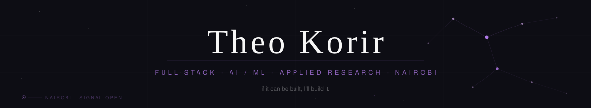

> I build things end-to-end: ML pipelines, Android automations, Android apps, production APIs, web apps. 
> Speech models fine-tuned in PyTorch. Platforms shipped solo. Pipelines running on nothing but a phone.

## Open Source Projects

### [Infra Risk Guardian — Terraform Plan Gatekeeper](https://github.com/spacey-cadet/infra-cost)
Decision API that reviews every terraform plan and returns a deterministic auto_apply or hold, built so it never auto-applies a change that quietly loosens security, especially a widened GitHub Actions OIDC trust condition. It parses Terraform's JSON plan (not scraped stdout) and runs a glob-aware semantic diff on the trust policy's sub/aud conditions, so it catches repo:you/repo:* as a superset of repo:you/repo:ref:refs/heads/main. A plain-Python OR-gate matrix is the sole authority and fails closed: it holds on any IAM resource change, an OIDC diff, a cost delta of $2/mo or 40% of baseline, a resource type never seen in the repo's plan history, or an unparseable plan. It now runs as a synchronous, SigV4-signed Lambda Function URL (IAM-authorised), with the old S3 and SQS hop removed. Pipelines call it through a small pip-installable infra-risk CLI that assumes a scoped role via GitHub OIDC and exits 0 for auto-apply, 2 for hold. Advisory layers (a Strands Agents explainer and an optional open-weight GLiNER2.5-Decide classifier running in the CI runner) add review context to the response but can never override the verdict. Each decision posts a GitHub check run and PR comment, escalates through SNS, and is logged with a human_override field in DynamoDB. Provisioned with Terraform under least-privilege OIDC roles, with Infracost estimates (heuristic fallback). Pytest fixtures cover the safe, expensive, OIDC-widening, and malformed plans and run without an AWS account.

`Python` `Strands Agents` `Terraform` `AWS Lambda` `SQS` `SNS` `DynamoDB` `S3` `GitHub Actions OIDC` `Infracost` `Docker` `pytest`

---

### [Scoopz](https://github.com/spacey-cadet/scoopz)
TikTok share-to-caption pipeline, rebuilt from a Termux script pair into a native Android app (Kotlin, Jetpack Compose). Share a link from TikTok and a Room-backed queue feeds WorkManager workers that download the video in HD (up to 3 in parallel, streamed to MediaStore with retries and de-duplication by video id) and write a ready-to-post caption. Frame picking is on-device: ML Kit scores sampled frames for sharpness, faces and on-screen text, and only the best one is sent. Captions are text-first, with a fast text model working from the title, OCR and image labels, and a vision model only on demand. Free-tier NVIDIA endpoints with a backup model, a rate limiter and Retry-After handling keep it at zero cost, and optional Groq Whisper transcription feeds spoken words into the prompt. A typed error matrix turns failures into a plain-language cause and fix, with an optional AI explainer that redacts keys before sending. A built-in "Find models" tool speed-tests which vision models a key can actually use. The original Termux pipeline (async workers, FastAPI control layer) is kept as a working legacy path.

**Impact:** the Termux version cut content processing ~58% (2 hrs → 50 min for 40 videos); the app moves the same flow into one tap with no terminal which makes it even faster.

`Python` `Kotlin` `Android` `FastAPI` `OpenAI API` `ffmpeg` `Termux`

---

### [Churn Escalation Detector — End-to-End MLOps Pipeline](https://github.com/spacey-cadet/churn-escalation)
Churn-risk scoring pipeline that runs unchanged in two modes, local Docker/SQLite and AWS Lambda/DynamoDB/S3, with identical training, gating, and serving code in both. Two-stage ETL data-quality gates (ingestion and transformation) block the pipeline and fire Slack/Discord alerts on failure. An XGBoost model with Platt calibration and two independently tuned cascade thresholds routes predictions into auto-resolve, review-queue, and senior-escalation tiers. A champion-challenger gate blocks any retrain that regresses PR-AUC on held-out or stress-test slices, backed by a versioned model registry with JSON model cards. The feature store does true point-in-time joins, an hourly drift monitor runs KS test and PSI, and a 21-day label-delay backfill recomputes precision/recall/F1 once ground truth lands. CI/CD runs on GitHub Actions with OIDC (no long-lived AWS keys) and canary rollouts via hashed customer routing.

`Python` `XGBoost` `FastAPI` `Docker` `AWS Lambda` `DynamoDB` `S3` `GitHub Actions`

---

### [Click-Fraud & Churn Risk Scoring Platform (ad-platform-ml)](https://github.com/spacey-cadet/ad-fraud)
Two real-time scoring services, click-fraud detection and churn prediction, share a feature base and deploy as either a free local Docker stack or a serverless AWS stack under a ~$15/month budget. The streaming pipeline (Redpanda + Faust locally; SQS → aggregator Lambda → DynamoDB in production) computes rolling per-user click-count windows for real-time fraud scoring. The AWS path is all Terraform (Lambda container images, DynamoDB, SQS + DLQ, SNS alerting, CloudWatch alarms/dashboards, GitHub OIDC deploy role) and avoids always-on services to stay within budget. Experiments are tracked in MLflow, and every local-vs-cloud architecture trade-off is documented in an ADR.

`Python` `LightGBM` `Redis/Feast` `Redpanda/Faust` `SQS` `DynamoDB` `Terraform` `Docker` `MLflow`

---

### [Speech Emotion Recognition — WavLM Fine-Tuning](https://github.com/spacey-cadet)
Fine-tuned a 24-layer Transformer for 8-class emotion recognition across RAVDESS, IEMOCAP, and CREMA-D. 77.3% accuracy in-distribution; cross-corpus testing exposed a 16–23pp generalisation drop, diagnosed via arousal/valence failure analysis — a known limit of self-supervised speech embeddings. Scoped fixes: adversarial domain adaptation, speaker disentanglement, Kenya-specific DAPT corpus.

`PyTorch` `HuggingFace` `WavLM` `SpeechBrain` `Transfer Learning`

---

### [WavLM SER — Production Inference Pipeline (Deployment)](https://github.com/spacey-cadet/ser-inference)
Rebuilt a single-endpoint inference demo into a production-grade serving pipeline (FastAPI + Docker on HuggingFace Spaces) covering calibration, drift monitoring, rollout, and latency, all on free-tier infrastructure. Offline-fit Platt/isotonic calibration and a two-threshold confidence cascade let uncertain predictions degrade gracefully instead of returning an overconfident wrong label. Input-validation and voice-activity-trimming gates feed a consent-gated feature-logging pipeline into a KS-test drift monitor and a low-confidence review/labeling queue. In-process champion/challenger canary routing is evaluated offline on PR-AUC and per-class F1 before any rollout. p50/p99 latency is tracked per request and gated on release, with testing and promotion automated through GitHub Actions.

`FastAPI` `Docker` `HuggingFace Spaces` `GitHub Actions` `Great Expectations`

---

### Pay Hero &nbsp;·&nbsp; *1st Place, Kenya Buildathon 2024*
Scalable B2B communication platform helping businesses engage customers at scale. Shipped under hackathon time pressure with a 2-person team, full-stack, and won against the full field.

`Scalable Architecture` `B2B` `Rapid Deployment` `Full-Stack`

---

### Production Web Platforms
Three production platforms — full lifecycle ownership, architecture to deployment to support.

| Platform | Description |
|---|---|
| **[Lisa Luxury Homes](https://lisaluxuryhomes.co.ke)** | Real-estate platform with dynamic routing, SEO optimisation, and WhatsApp conversion flow. |
| **[FunFiesta Kenya](https://funfiestakenya.com)** | Booking platform for a kids' events business. Mobile-first, end-to-end. |
| **[Rafi](https://rafi.co.ke)** | Student mental-health platform: wellbeing tracking, risk detection, counsellor routing. |

`Next.js` `React` `Node.js` `REST APIs` `Vercel` `SEO`

---

## Stack

**AI / ML**&nbsp;&nbsp;

 
**Classical ML**&nbsp;&nbsp;

**Languages**&nbsp;&nbsp;

**Frontend**&nbsp;&nbsp;

**Backend**&nbsp;&nbsp;

**Mobile & DevOps**&nbsp;&nbsp;

---

## Experience

**Machine Learning Engineer Intern · JHUB Africa** &nbsp;·&nbsp; *May – Aug 2024*
- Integrated ML models into production systems (React + FastAPI), owning the connection between model outputs and the UI.
- Designed RESTful APIs bridging backend inference pipelines with frontend components.
- Reviewed code and presented technical work to non-technical stakeholders on an async, remote-distributed team.

**Full-Stack Developer · Independent Clients (Freelance)** &nbsp;·&nbsp; *2024 – 2025*
- Architected, deployed, and maintained 3 production web applications solo, 100% on-time delivery.
- Owned the full workflow: REST API design, version control, Vercel deployment, SEO, post-launch support.

---

## Education

**BSc Computer Science** — Jomo Kenyatta University of Agriculture & Technology *(Expected 2026)*
Data Structures & Algorithms · Artificial Intelligence · Operating Systems · System Design · OOP · Cryptography · Probability & Statistics · Internet Application Programming

---

## Contact

&nbsp;

&nbsp;

&nbsp;

---

 
Nairobi, Kenya

